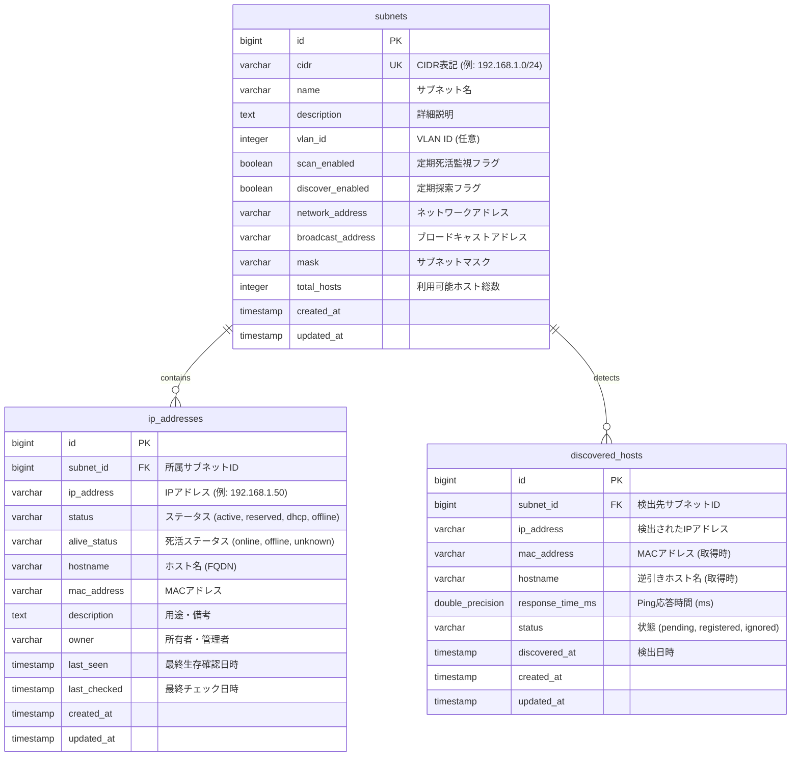

# データベース物理設計書 (Database Schema Design)

## 1. 概要
- **DBMS**: PostgreSQL 16
- **文字コード**: UTF-8
- **タイムゾーン**: UTC (または JST)

---

## 2. ER図 (Entity Relationship Diagram)

---

## 3. テーブル詳細定義

### 3.1 `subnets` テーブル (サブネット)
| カラム名 | データ型 | NULL | 初期値 | 説明 |
| :--- | :--- | :---: | :--- | :--- |
| `id` | BIGSERIAL | NO | (自動) | サブネットID (主キー) |
| `cidr` | VARCHAR(18) | NO | | CIDR表記 (ユニーク) |
| `name` | VARCHAR(100) | NO | | サブネット識別名 |
| `description` | TEXT | YES | NULL | 説明・メモ |
| `vlan_id` | INTEGER | YES | NULL | VLAN番号 (任意) |
| `scan_enabled` | BOOLEAN | NO | true | 定期死活Pingを実行するか |
| `discover_enabled`| BOOLEAN | NO | true | 定期ホスト探索を実行するか |
| `network_address`| VARCHAR(15) | NO | | ネットワークアドレス (自動計算) |
| `broadcast_address`| VARCHAR(15)| NO | | ブロードキャストアドレス (自動計算) |
| `mask` | VARCHAR(15) | NO | | サブネットマスク (自動計算) |
| `total_hosts` | INTEGER | NO | 0 | 利用可能ホスト総数 (自動計算) |
| `created_at` | TIMESTAMPTZ | NO | CURRENT_TIMESTAMP | 作成日時 |
| `updated_at` | TIMESTAMPTZ | NO | CURRENT_TIMESTAMP | 更新日時 |

- **インデックス**:
  - `idx_subnets_cidr`: UNIQUE (`cidr`)

---

### 3.2 `ip_addresses` テーブル (IPアドレス割り当て台帳)
| カラム名 | データ型 | NULL | 初期値 | 説明 |
| :--- | :--- | :---: | :--- | :--- |
| `id` | BIGSERIAL | NO | (自動) | IPアドレスID (主キー) |
| `subnet_id` | BIGINT | NO | | 所属サブネットID (外部キー) |
| `ip_address` | VARCHAR(15) | NO | | IPv4アドレス |
| `status` | VARCHAR(20) | NO | 'active' | 管理ステータス (`active`, `reserved`, `dhcp`, `offline`) |
| `alive_status` | VARCHAR(20) | NO | 'unknown'| 死活ステータス (`online`, `offline`, `unknown`) |
| `hostname` | VARCHAR(255) | YES | NULL | ホスト名・DNS名 |
| `mac_address` | VARCHAR(20) | YES | NULL | MACアドレス |
| `description` | TEXT | YES | NULL | 用途・メモ |
| `owner` | VARCHAR(100) | YES | NULL | 所有者・担当部署 |
| `last_seen` | TIMESTAMPTZ | YES | NULL | 最後にPing応答があった日時 |
| `last_checked` | TIMESTAMPTZ | YES | NULL | 最後に死活チェックした日時 |
| `created_at` | TIMESTAMPTZ | NO | CURRENT_TIMESTAMP | 登録日時 |
| `updated_at` | TIMESTAMPTZ | NO | CURRENT_TIMESTAMP | 更新日時 |

- **外部キー**:
  - `fk_ip_addresses_subnet`: `subnet_id` REFERENCES `subnets(id)` ON DELETE CASCADE
- **インデックス**:
  - `idx_ip_addresses_subnet_ip`: UNIQUE (`subnet_id`, `ip_address`)

---

### 3.3 `discovered_hosts` テーブル (未登録の検出ホスト候補)
| カラム名 | データ型 | NULL | 初期値 | 説明 |
| :--- | :--- | :---: | :--- | :--- |
| `id` | BIGSERIAL | NO | (自動) | 検出ID (主キー) |
| `subnet_id` | BIGINT | NO | | 検出先サブネットID (外部キー) |
| `ip_address` | VARCHAR(15) | NO | | 応答があった未登録IP |
| `mac_address` | VARCHAR(20) | YES | NULL | 取得できたMACアドレス |
| `hostname` | VARCHAR(255) | YES | NULL | 逆引きDNSホスト名 |
| `response_time_ms`| DOUBLE PRECISION | YES | NULL | Ping応答時間 (ミリ秒) |
| `status` | VARCHAR(20) | NO | 'pending' | 候補状態 (`pending`, `registered`, `ignored`) |
| `discovered_at`| TIMESTAMPTZ | NO | CURRENT_TIMESTAMP | 検出日時 |
| `created_at` | TIMESTAMPTZ | NO | CURRENT_TIMESTAMP | 作成日時 |
| `updated_at` | TIMESTAMPTZ | NO | CURRENT_TIMESTAMP | 更新日時 |

- **外部キー**:
  - `fk_discovered_hosts_subnet`: `subnet_id` REFERENCES `subnets(id)` ON DELETE CASCADE
- **インデックス**:
  - `idx_discovered_hosts_subnet_ip`: UNIQUE (`subnet_id`, `ip_address`)

